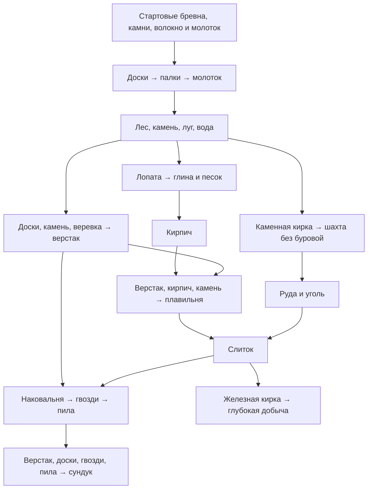

# Профиль экономики закрытого теста v1

Дата: 2026-10-16. Код: `economy-closed-test-v1`. Статус: **candidate, не опубликован в игре**. Основание — [economy.md](../tz/economy.md), решения владельца и [CONTENT](../plan/2026-10-16-world-economy-content.md). Машиночитаемые значения: [closed-test-v1.json](../../yii2/common/modules/world/data/economy/closed-test-v1.json).

Профиль содержит 57 предметов, 44 рецепта (40 существующих и 4 новых), 22 новых/изменяемых объекта и 14 действий источников/культивации. Это контракт будущих изменений, а не второй каталог с остатками. Его нельзя напрямую импортировать через CraftCatalog: существующие ID, состояния, изучение рецептов и правки администратора сохраняются будущим адаптером применения.

## Публикация и совместимость

Загрузка JSON и команда аудита ничего не меняют в БД. `effective_from=null`; фактическое включение требует завершения BAL:A4/A5, миграционной матрицы ECO:A3 и дальнейших проверок. Файл хранится в Git; локальные выгрузки `docs/temp/world` не нужны для выполнения аудита.

Публикация будет явной, версионированной и аудируемой. Новые операции используют новую версию, принятые операции/стройки/посевы — сохранённые условия. Повтор установки не переоткрывает `world_start_claim`, не изымает вещи и не сокращает оплаченные права. Ранее превышенные ограничения блокируют новое размещение, сохраняя доступ к существующему имуществу. Старые проводки не пересчитываются.

Cr имеют четыре десятичных знака; денежные поля JSON — строки. Физические количества — целые. Все указанные секунды — реальные. Стройка и источники используют труд; крафт остаётся мгновенным (`work_seconds=0`). Коэффициент календаря мира 60 не ускоряет сроки этого профиля повторно. Банк, платный старт, пополнение и рублёвый эквивалент отсутствуют.

## Принятые значения и причины отличий

| Вопрос | Значение v1 |
| --- | --- |
| Начальный баланс | Целевые 250 Cr из итоговых §17/23/24; готовятся существующим переводом, не начисляются вступлением |
| Стартовые вещи | 4 бревна, 6 камней, 6 волокон, 4 воды, 2 семени, молоток и эликсир; один lifetime claim |
| Ежедневный сбор | 2 бревна, 2 камня, 2 волокна, 2 воды, трава; 0 денежных Cr; существующая ночная эффективность учитывается отдельно |
| Доски/палки/гвозди | Бревно → 2 доски; доска → 4 палки; слиток → 10 гвоздей; последние два выхода — итоговые поправки §8.3 |
| Цены продажи | Последняя таблица §9: доска 1,5, верёвка 8, слиток 24, гвоздь 4, кирпич 8, стекло 10 за единицу; партия оценивается умножением |
| Цена сырья для расчёта | §3, для слитка последняя оценка 24; `reference_price_cr` не является предложением покупки и не открывает NPC-магазин |
| Крафтовая плата | Сохранены фиксированные целые `cost_credits` текущих 40 рецептов, новые начальные рецепты бесплатны. Дополнительные 10% за станцию сейчас не вводятся: это неподтверждённый второй сбор и конфликт с текущим контрактом |
| Костёр | Существующий предмет `classic-campfire`, материалы 3 бревна + 4 камня; место `campfire-place` стоит 0. Число 40 из таблицы построек не становится вторым тарифом за тот же костёр |
| Сундук | Существующий `classic-chest`: 8 досок + 8 гвоздей, верстак, пила, плата 1 Cr; новое здание «сундук» не создаётся |
| Шахта/кузница | 8 досок + 6 камней / 10 досок + 12 камней; по 300 секунд, цены 120/150 Cr; явные изменения §7.2 имеют приоритет над старой таблицей |
| Дом/склад/буровая | Дом 7200 сек.; склад 80 досок + 60 камней + 25 верёвок; буровая 250 досок + 300 камней + 80 слитков + 60 верёвок; остальные значения в JSON |
| Сырая шкура/кожа | Ловушка даёт существующую `classic-hide` (сырая шкура), а существующий `classic-leather` меняется на 1 шкуру + 1 воду → 1 кожу. Цена 6/15; второй параллельной цепочки нет |
| Ловушка | 1 шкура через 6 реальных часов; повторный цикл начинается после получения. Альтернативные 10 минут не создают второй путь выдачи |
| Ранняя добыча | Каменная кирка из 3 камней + 2 палок, без слитка/наковальни. Шахта работает без буровой; фиксированные выходы 3 камня / 2 угля / 1 руда, без клиентского RNG |
| Теплица | Рост ×0,8; контракт защиты `light_crop_damage` — серверное снижение на 50% потери урожая от событий с исходной потерей ≤25%. Обработчик и отображение эффекта ещё реализуются в CONTENT:B3, простое наличие настройки не считается защитой |
| Неоценённые предметы | `sale_price_cr=null`: нет разрешённой продажи этим каналом; неизвестная цена не заменяется нулём. Расширение матрицы — BAL/ECO |

## Коды новых сущностей и соответствие названиям ТЗ

12 объектов: `forest-plot`, `stone-plot`, `clay-plot`, `sand-plot`, `meadow-plot`, `water-source`, `campfire-place`, `trap`, `cookfire`, `workshop-building`, `storage-building`, `small-greenhouse`. Их цены/материалы/время заданы непосредственно в JSON. Хозсклад имеет 50 слотов; большой склад — 100. Остальные изменения хранения и пакеты расширения ещё проверяются в BAL:C1/ECO:B4.

| Название/код ТЗ | Каноническая сущность v1 |
| --- | --- |
| Каменная кирка | Новый предмет и рецепт `world-stone-pickaxe`; железная `classic-pickaxe` остаётся улучшением |
| Лопата | Существующий предмет/рецепт `world-shovel`, без добавления `classic-shovel` |
| `cook-carrot` | Новый предмет/рецепт `world-cooked-carrot`, +15 здоровья |
| Овощной отвар | Новый предмет/рецепт `world-vegetable-broth`, +30 здоровья |
| Походный паёк | Новый предмет/рецепт `world-travel-ration`, +20 здоровья |
| `make-hide` | Изменение `classic-leather`, а не новый рецепт с альтернативным выходом |
| `make-raw-hide` | Действие ловушки, выдаёт `classic-hide` |
| `plant-carrot` / `harvest-carrot` | Действующие команды `world.crop.sow` / `world.crop.harvest`; в профиле harvest агрегирует полный цикл только для анализа, это не новый бесплатный рецепт |
| `starter-carrot-seeds` | Существующий рецепт: 1 морковь → 2 семени, плата 0 |
| `gather-*`, `mine-stone`, `deep-mining` | Действия источника с трудом/кулдауном, не рецепты CraftCatalog без ингредиентов |

Кулинарные рецепты используют возможность объекта `cookfire`, а не станцию-предмет с несуществующим ID. Обычные станции — существующие верстак/плавильня/наковальня. Общая модель размещения сохраняется: свой активный родитель, включённый доступный шаблон, глубина <32; перечень рекомендуемых родителей в ТЗ не становится новой жёсткой иерархией.

Для будущих новых правил обязательные цены стройки/ячеек и платы огорода направляются в существующий бюджет поселения, из действующего бюджета плательщика с явным личным взносом при необходимости. Труд владельца бесплатен, резерв помощников отделён от обязательной цены. Ремонт пока сохраняет опубликованные условия, крафтовая плата — действующую проводку. Эти направления должны быть реализованы/сверены в ECO, они не меняются одним чтением файла профиля.

## Граф получения ресурсов и станций



Начальные материалы позволяют изготовить доски для первых источников до добычи нового сырья. Молоток из набора позволяет собирать дерево/камень; отдельное изготовление молотка засчитывает цель дня 1. Путь к сундуку включает пять слитков на наковальню и два на пилу, помимо гвоздей: его нельзя считать ранним предметом только по строке «8 досок + 8 гвоздей».

После сокращения ежедневного сбора пропадёт прежняя выдача `world-magic-herb`. Чтобы рецепт эликсира не стал невоспроизводимым, добавляется действие `gather-magic-herb` на лугу: 1 волшебная трава, 600 секунд труда, не чаще раза в сутки; оно также расходует общую квоту добычи. Лечебная `classic-herb` остаётся отдельным ресурсом. Это обнаруженный разрыв текущей реализации, дополняющий перечень §5.

Проверка графа подтверждает наличие физических зависимостей, включая инструменты, изучение предшествующих рецептов, станции и контекст. Она не доказывает наличие нужного количества вещей, денег, слотов, уровня навыка или достижимость за сутки: это оставшиеся сценарии BAL:B–D.

## Возможности действий и защита выдачи

Каждое действие JSON задаёт объект-источник, целочисленный выход, инструмент, реальные секунды, плату, XP, выходное canonical storage и квоту. Вход команды — свой активный `node_id`, `action_code`, доступный инструмент и выходное хранилище; идентификаторы/цены/результат перепроверяются сервером. Состояние включает версию профиля, труд/кулдаун, остаток квоты и единственный неполученный результат.

Лес/камень требуют молоток, глина/песок — лопату, ручная шахта — каменную кирку, глубокая добыча — железную. Одна завершённая партия расходует одну единицу рабочего износа подходящего инструмента; существующие правила станций/ночной эффективности учитываются дополнительно. Источники используют единственную трудовую сессию игрока и текущий предел heartbeat/offline, а не добавляют параллельного работника.

Полный склад оставляет не более одной ожидающей партии с сохранёнными условиями/трудом; новая партия не начинается до доставки или явного отказа от неполученного результата. Списание износа, выдача, XP и расход квоты фиксируются однократно под блокировкой. Replay воспроизводит итог; ошибка до commit не расходует квоту. Перезапуск worker и удаление источника не выпускают вторую партию. Интеграция в текущий Mining/CommandBus выполняется в CONTENT:C4/ECO:C/D.

| Условие | Контракт отказа |
| --- | --- |
| Нет доступа/объект неактивен | Действующая ошибка прав/состояния мира, без раскрытия чужого хранилища |
| Несовместимое действие/источник | `RESOURCE_UNAVAILABLE`, без попытки выдать альтернативный ресурс |
| Другая стройка/добыча | Существующие `BUILDER_BUSY` / `MINER_BUSY` |
| Нет инструмента / он сломан | `RESOURCE_TOOL_REQUIRED` / `RESOURCE_TOOL_BROKEN`, без начала труда |
| Не закончился цикл | `RESOURCE_NOT_READY` и серверное время готовности |
| Исчерпана квота | `ECONOMY_LIMIT_EXCEEDED` с остатком и временем восстановления |
| Нет места | Понятное состояние ожидающей доставки; предыдущий результат не исчезает |
| Изменилась версия/цена/ревизия | Действующий конфликт preview/CommandBus, требуется новое подтверждение |

Новые коды выше — контракт предстоящих обработчиков, а не уже доступные API. Реальный errors-контракт и fixtures обновляются в ECO:A2/E4; нынешние потребители сохраняют прежние маршруты.

Еда использует существующее здоровье: одно списание предмета, прибавка 15/30/20 с ограничением текущим максимумом, общий lock с ночным расчётом. При полном здоровье `HEALTH_FULL`, предмет не расходуется. Потеря ответа после commit не повторяет лечение.

## Морковь и фактические расходы

Профиль: 1 семя и 1 вода при посадке, ещё 1 вода при поливе; рост 1800 секунд, полив с 900-й секунды, окно до созревания, урожай 3 при полной эффективности и соблюдении полива. Плата за вскапывание 2 Cr и за один полив 2 Cr. Начатые старые циклы сохраняют свои условия 300 секунд/выход 4 либо тестовый выход 3.

При сохранении одной моркови на 2 семени выручка от двух других — 5 Cr, денежная плата — 4 Cr, остаток денежных поступлений — 1 Cr. Это ещё не полная прибыль: расходуются две воды и семя, возникает одно дополнительное семя, действуют износ и ночная эффективность. Отчёт хранит натуральные остатки отдельно от фактически полученных Cr.

## Карта, квоты и стартовые цели

На стоянке первоначально открыты центральные 3×3 ячейки, предел 5×5. Следующие имеют цену `4 Cr × кольцо`, пакет от трёх — скидку 5% через действующее точное распределение. У прочих объектов остаётся одна начальная ячейка; цели трёх исследований учитывают реальные команды на любой своей карте, включая вложенные карты с первым кольцом, доступным исследователю уровня 1. Девять подаренных ячеек не выдаются за три действия исследования и не расходуют эликсир.

Квоты пользователя общие в активном мире между городами. Сутки Europe/Moscow; крафт — скользящие 3600 секунд, 30 **партий**, а не 30 HTTP-запросов. Запрос на N партий занимает N единиц; 10 гвоздей за одну партию занимают одну. Все ресурсные действия, включая ловушку и волшебную траву, занимают по одной из 20 суточных партий добычи. Ежедневный сбор — отдельная квота 1. Продажи — 20 операций/500 Cr валовой выручки/10 одинаковых в операции, с общим контролем прежних каналов.

Пределы объектов считаются по пользователю в активном мире, включая новые стройки и размещённые физические экземпляры; запасные вещи в рюкзаке не являются размещёнными кострами/сундуками. Все коды мини-склада образуют одну группу. Отменённые/архивные размещения не занимают квоту, повтор команды не увеличивает счётчик. Предел 1 постройка на ячейку относится к конкретной карте, не к сумме всех вложенных карт.

Цепочки дня 1–2 используют серверные факты §15. Награды: 50 Cr/20 XP/эликсир и 100 Cr/30 XP/слиток. Денежные награды обеспечиваются резервом существующего бюджета поселения до доступного claim; при нехватке бюджета запрещены эмиссия и списание в минус. Неограниченный квестовый движок не нужен. Профиль не считает ещё не полученные награды начальным балансом. Сундук/продажа — продолжение маршрута, не новые скрытые условия награды дня 2.

## Аудит и следующие проверки

```sh
php yii world-audit/economy-profile
php tests/release/world-economy-profile.php
```

Команды выполняются из `yii2`; аудит не требует подключения к БД. JSON-отчёт различает цену единицы/партии, стоимость материалов по продаже/справочнику, плату и маржу до износа. Для ежедневного набора справочная стоимость **29 Cr**, оценка продажи **14,5 Cr**, фактическая денежная выдача **0 Cr**. Сумма цен шести объектов выбранного дня 1 — **180 Cr**, без материалов, труда, ремонта и последующих действий; это не доказательство полного бюджета дня.

Для верёвки маржа до износа из своего сырья +3,5 Cr, по справочной замене сырья −1 Cr. Поэтому цена «покупки» и натуральный сбор не взаимозаменяемы. Маржа считается относительно выбранной стоимости ингредиентов; проценты не вычисляются при неизвестном/нулевом основании. Бесконечные циклы перепродажи проверяются отдельно при проектировании NPC-профиля MKT:A2.

До BAL:A5 остаются полный учёт износа/ремонта/обслуживания, обеспеченного спроса, цены расширений, и сценарии количества/квот/времени дня 1–2 и недели. После этого выполняются миграции и подключение профиля к существующим командам. Отсутствие заблокированных узлов в графе не закрывает эти проверки и не разрешает включить профиль в игре.
