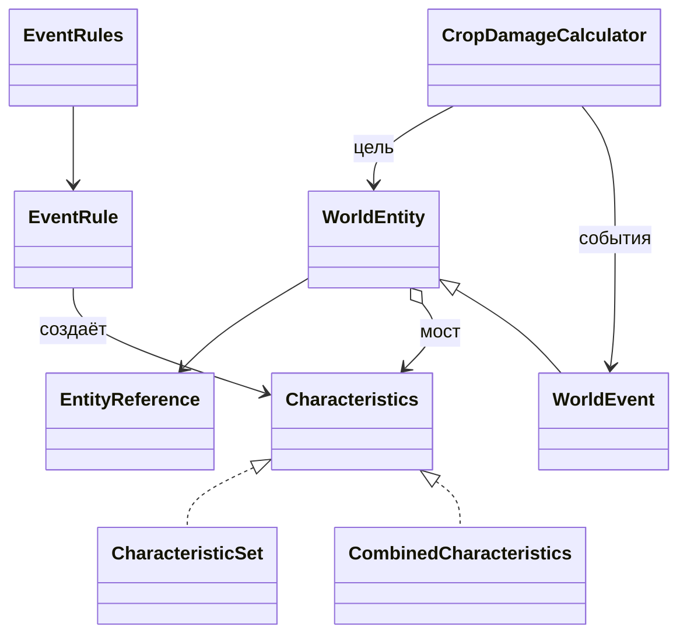

# События и характеристики мира

Основа от 2026-10-30. Чистый код находится в `yii2/common/modules/world/domain`; он не загружает Yii, БД, глобальные часы или настройки приложения. Первый рабочий потребитель — существующее влияние событий на урожай. Новых игровых эффектов, таблиц или публичных полей API эта работа не добавляет.

## Две независимые оси: Мост

`WorldEntity` связывает идентичность сущности с интерфейсом `Characteristics`. Вид сущности и её жизненный цикл развиваются отдельно от реализаций характеристик. Это позволяет одному объекту, предмету или событию использовать несколько характеристик без классов для каждой комбинации.

| Сторона | Контракт | Ответственность |
| --- | --- | --- |
| Сущность | `EntityReference`, `WorldEntity` | Идентичность и доступ к подключённым характеристикам |
| Событие | `domain/events/WorldEvent` | Уточняет сущность: область действия, статус, временной интервал |
| Характеристики | `Characteristics` | Предзагруженные именованные группы данных, без I/O |
| Один набор | `CharacteristicSet` | Снимок значений; технические имена групп и только массивы/конечные скалярные значения |
| Объединение | `CombinedCharacteristics` | Объединяет независимые наборы; отклоняет конфликт одинаковых имён |
| Правило события | `EventRule`, `EventRules` | Проверяет конфигурацию правила и переводит её в характеристики |
| Расчёт эффекта | `CropDamageCalculator` | Соединяет характеристики события и цели, возвращает расчёт без записи |



Ссылка содержит вид и ID: `node:7`, `item:7`, `event:7` различны. `item` обозначает определение предмета; экземпляры при необходимости получают отдельный вид, например `equipment_instance`. Набор видов не зашит в перечисление: новый вид не требует изменения существующих характеристик. Разрешённые виды конкретной команды по-прежнему проверяет её обработчик.

Пример подключения одних характеристик к разным сущностям:

```php
use common\modules\world\domain\{EntityReference, WorldEntity};
use common\modules\world\domain\characteristics\{CharacteristicSet, CombinedCharacteristics};

$features = new CombinedCharacteristics(
    new CharacteristicSet(['durability' => ['current' => 80, 'maximum' => 100]]),
    new CharacteristicSet(['storage' => ['slots' => 12]])
);
$object = new WorldEntity(new EntityReference('node', 7), $features);
$item = new WorldEntity(new EntityReference('item', 7), $features);
```

Это пример доменного снимка, а не новый формат хранения или API. Существующие модели объектов и предметов пока не переведены целиком на `WorldEntity`. Их адаптеры смогут подключать характеристики постепенно. Права, деньги и служебные поля не копируются в характеристики автоматически.

Группа имеет устойчивое техническое имя (`crop.damage`, `event.protection`), а не подпись интерфейса. Отсутствующая группа возвращает `null`. Проверку конкретных полей, диапазонов и единиц выполняет владелец правила: сам `CharacteristicSet` не превращает произвольные данные в разрешённый игровой эффект. Для денег сохраняется действующий контракт `Money`, на границе снимка — точная десятичная строка или целые минимальные единицы, не `float`.

Объединение двух `durability` или двух `crop.damage` запрещено даже при одинаковых значениях. Если потребуются сумма бонусов, приоритет экипировки или временное замещение, соответствующая доменная политика должна сначала вычислить один итоговый набор. Неявных `array_merge` с потерей значений нет. Сумма урона от разных событий остаётся отдельной политикой расчёта с пределом 10000 bps.

## Жизненный цикл и область события

`domain/events/WorldEvent` — неизменяемый снимок существующей записи `world_event`. Он не заменяет `models/WorldEvent` (ActiveRecord). Конструктор принимает явные сроки и характеристики; методы получают явное серверное время.

- `activeAt($now)` использует полуинтервал `[startsAt, endsAt)`. `endsAt = null` означает отсутствие срока; только статус `active` виден как действующее событие.
- `affectsScope($ids)` принимает целочисленные ID узла и предков. Дочерняя область получает событие предка, соседняя ветвь — нет. Переданные ID не являются доказательством доступа: адаптер обязан получить их на сервере.
- `overlaps($from, $until, $observedAt)` нужен для истории урожая. Будущие события и `draft` исключаются. Событие, завершённое в пределах рассматриваемого цикла, сохраняет влияние. Прежнее правило `closed` сохранено: если конец отсутствует или ещё не наступил, эффект не учитывается. Начало ровно в текущую секунду учитывается; касание конца посева или начала сбора — нет.

`CultivationEnvironment` загружает предков и события пакетно, преобразует их в доменные снимки и вызывает `CropDamageCalculator`. Расчёт получает уникальные события в порядке ID и принятый при посеве набор защиты. Он не ищет новые преимущества теплицы во время сбора и не читает БД. Результат сохраняет прежний контракт: `loss_bps` и упорядоченные `effects` с `event_id`, исходным и уменьшенным уроном. Экономические изменения остаются в существующей команде сбора.

`models/WorldEvent::validateRules` использует тот же реестр правил, что расчёт. Сообщения ошибок и старые допустимые формы JSON сохранены. При записи неизвестные правила запрещены; при чтении старой записи неизвестный или повреждённый эффект игнорируется, независимый корректный эффект продолжает работать. Произвольные PHP-классы из JSON не создаются.

## Добавление нового направления

1. Определить имя группы, поля, единицы и правила совместимости; для нового события реализовать `EventRule` с валидацией и созданием характеристик.
2. Зарегистрировать правило в `EventRules::standard()` — общей точке сборки текущих Yii-адаптеров. Изолированному потребителю можно передать собственный `EventRules` через конструктор, без глобальных подписок.
3. Добавить отдельный чистый расчёт, читающий нужную группу. Новые бонусы не должны попадать в старый расчёт урона только потому, что они присутствуют у события.
4. Подключить расчёт к существующей авторизованной команде; изменения ресурсов, истории и квитанции выполнять одной транзакцией с защитой от повтора.
5. Проверить границы времени, область, сочетания, повторы и отказы записи. При изменении публичного API отдельно согласовать DTO, SPA и Insomnia.

Реестр правил и семейство сущностей не требуют взаимного наследования. Тест с дополнительным правилом скорости показывает, что оно объединяется с уроном без изменения классов сущности, события и текущего расчёта урожая. Сам эффект скорости в игру не включён.

## Связь с деревом и доставкой уведомлений

Компоновщик `WorldComponent` / `WorldComposite` и Посетитель `WorldVisitor` продолжают обслуживать иерархию нод. Предмет в инвентаре и событие с областью действия не становятся фиктивными дочерними нодами. Их связь с деревом задают ссылки и область; для будущего общего обхода предметов/событий потребуется явно определить отношения владения, размещения и действия, а также фильтрацию доступа.

`world_event` описывает игровое явление. `game_outbox` описывает уведомление о состоявшейся операции, например `world.node.changed`. Это разные жизненные циклы. Существующие `Outbox`, `EventSubject`, очередь заданий и `game_inbox` остаются механизмом доставки и защиты от повторной обработки. Расчёт характеристик не публикует уведомления и не выполняет внешние вызовы.

Фундамент не добавляет планировщик событий, автоматическое начисление наград, новые погодные эффекты или универсальную таблицу характеристик. Такие операции подключаются по конкретным игровым требованиям с существующими middleware и журналами; сами расчёты уже можно использовать без Yii.

## Проверки

- `php -n yii2/tests/release/world-event-domain.php`: без Composer/Yii/БД; четыре вида сущностей, объединение характеристик, конфликты, расширение реестра, границы времени и области, прежняя валидация и 500 сравнений с исходным алгоритмом урожая.
- `php yii2/tests/release/world-event-foundation.php`: одноразовая разрешённая БД; реальные модели и запросы, активные события предков, соседняя ветвь, закрытие, повреждённые старые правила, сохранность DTO и запрет доступа к чужой приватной ноде. Повторный расчёт не меняет журналы.
- `php yii2/tests/release/world-economy-gameplay.php`: прежний полный игровой маршрут, включая урожай и теплицу.

Два новых сценария включены в изолированную группу полного backend CI. Схема БД и механизм блокировок не менялись.

Локально 2026-10-30 пройдены: lint 14 PHP-файлов, чистая проверка событий без Yii (500 временных сценариев), прежняя проверка Компоновщика/Посетителя, интеграционная проверка на SQLite/MariaDB/PostgreSQL и полный игровой маршрут на SQLite. Использовались отдельные тестовые базы; данные работающего приложения не изменялись. Удалённый CI не запускался.
